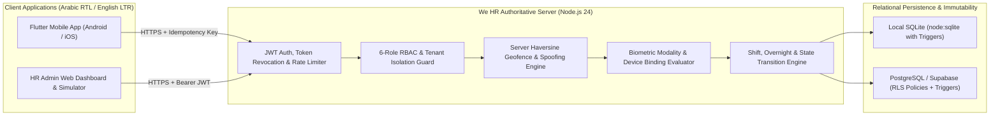

# We HR — Architecture, Security, Privacy & Manual Device QA Guide

## 1. System Architecture Overview

---

## 2. Biometric Security Model & Limitations

### What Local OS Biometrics Prove vs. Do Not Prove
1. **What Android `BiometricPrompt` and iOS `LocalAuthentication` do**:
   - The operating system verifies locally inside the device's Secure Element / Trusted Execution Environment (TEE) that the person holding the phone matched a biometric template enrolled on that device.
   - Raw fingerprint images or facial geometry **never** leave the OS and are never accessible to We HR.
2. **Distinguishing Biometrics from PIN/Pattern**:
   - In Flutter (`mobile_flutter/lib/services/biometric_auth_service.dart`), We HR invokes `local_auth` with `AuthenticationOptions(biometricOnly: true)` when company/workplace policy requires biometrics.
   - On the backend (`backend/src/domain/biometrics.js`), `biometric_verified` is recorded as `true` **only** when `authMethod` is `biometric_strong` or `biometric_weak` and hardware + enrollment are confirmed. If a device returns `device_credential` (PIN/passcode), the backend rejects the punch (`BIOMETRIC_REQUIRED_PIN_NOT_ACCEPTED`) unless the employee has an explicit HR-approved exception (`allow_biometric_exception`).
3. **Mitigating "Buddy Punching" on Shared Phones**:
   - Because an OS biometric prompt accepts *any* fingerprint enrolled in the phone's settings, Employee A could theoretically log into their We HR account on Employee B's phone and let Employee B scan their finger.
   - **We HR Controls**:
     - Every attendance request includes the device identifier (`device_identifier`).
     - If the device identifier is registered to another employee in `approved_devices`, the backend flags `SHARED_DEVICE_USED_BY_ANOTHER_EMPLOYEE` (or rejects immediately with `SHARED_DEVICE_PROHIBITED` when `require_approved_device` is enabled).

---

## 3. Employment Law & Data Privacy Notes (Egypt & Saudi Arabia)

> **Important Disclaimer**: The notes below are engineering privacy guidelines, not formal legal counsel. Consult qualified local legal counsel in Egypt and Saudi Arabia before commercial deployment.

### Egypt
- **Personal Data Protection Law (PDPL — Law No. 151 of 2020)**:
  - Location coordinates and employment records constitute protected personal data.
  - **Minimization Implemented**: We HR collects GPS coordinates **only** at the moment the employee actively taps Check-In/Check-Out (`NSLocationWhenInUseUsageDescription` / `ACCESS_FINE_LOCATION` foreground only; no continuous background tracking).
  - **Biometric Templates**: Because biometric matching occurs strictly inside the phone's OS and We HR stores only a boolean verification flag (`biometric_verified: true/false`), We HR avoids storing sensitive biometric templates on servers.
- **Egyptian Labor Law (Law No. 12 of 2003 / updated provisions)**:
  - Keep immutable records of original attendance timestamps alongside any manager-approved adjustments (`attendance_corrections`) so working-hour and overtime calculations remain auditable.

### Saudi Arabia (KSA)
- **Saudi Personal Data Protection Law (PDPL — Royal Decree M/19)**:
  - Requires clear Arabic disclosure (`i18n.js` / `Info.plist`) explaining why location data is collected and how long attendance logs are retained.
  - Cross-border data transfer rules apply: when deploying to cloud PostgreSQL/Supabase for Saudi enterprise clients, host the database in a regional data center (or compliant GCC region) and enforce strict tenant isolation.
- **MHRSD (Ministry of Human Resources and Social Development)**:
  - Electronic attendance registers must preserve an auditable trail of shift schedules, late arrivals, overtime, and leave approvals.

---

## 4. Manual Physical-Device QA Checklist

When you install the Flutter SDK and connect a physical Android phone or iPhone, execute the following manual hardware tests before production release:

| # | Test Scenario | Steps on Physical Device | Expected Result |
| :- | :--- | :--- | :--- |
| 1 | **Android Fingerprint Match** | Log in as `ahmed.saeed@niledelta.eg` inside geofence -> Tap Check-In -> Touch fingerprint sensor | OS `BiometricPrompt` succeeds; backend records `biometric_verified = true`, `sync_status = accepted`. |
| 2 | **Android Face Unlock** | Use an Android handset with Class 3 Face Unlock enrolled -> Tap Check-In | OS prompt authenticates; backend records `accepted`. |
| 3 | **iPhone Face ID / Touch ID** | Run on iPhone with Face ID enrolled -> Tap Check-In | iOS shows `NSFaceIDUsageDescription` prompt on first use, authenticates Face ID, records `accepted`. |
| 4 | **Device Without Enrolled Biometrics** | Remove fingerprints in phone Settings -> Tap Check-In as strict employee vs. exception employee (`sara.kamal@niledelta.eg`) | Strict employee is blocked with clear `NOT_ENROLLED` message; exception employee is permitted via `exception_fallback` with `biometric_verified = false`. |
| 5 | **Denied Location Permission** | Deny location permission when prompted -> Tap Check-In | App displays clear explanation why location is needed and does not crash or submit invalid coordinates. |
| 6 | **Approximate / Indoor Poor GPS** | Test inside a basement where GPS accuracy > 50m | Server rejects with `POOR_LOCATION_ACCURACY` and displays reported accuracy vs. threshold. |
| 7 | **Mock Location App (Android)** | Enable a Fake GPS app in Android Developer Options -> Tap Check-In | `pos.isMocked` is `true`; server rejects with `MOCK_LOCATION_DETECTED` and logs alert on HR dashboard. |
| 8 | **Airplane Mode / Offline Sync** | Turn on Airplane Mode -> Tap Check-In -> Turn off Airplane Mode -> Tap Sync | While offline, event is clearly labeled `PENDING` (never falsely shown as accepted). After sync, server revalidates and records as `needs_review`. |
